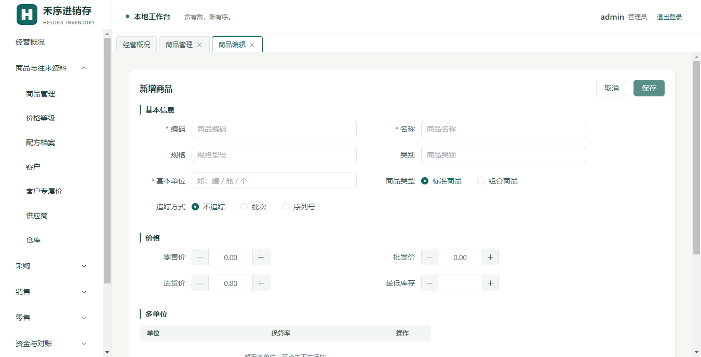
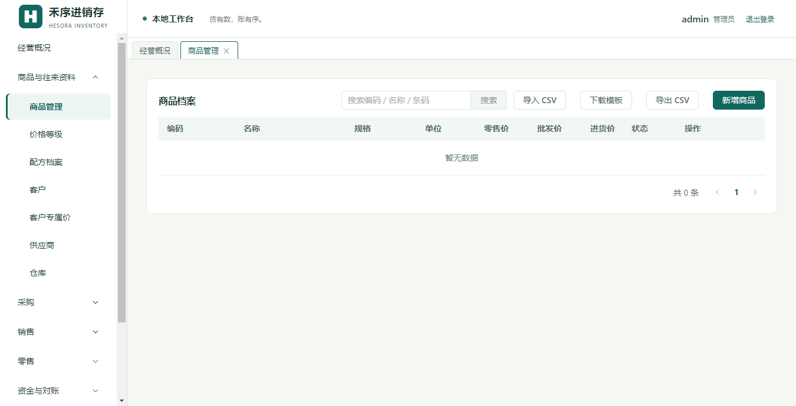

# 禾序进销存 用户使用手册

| 项目 | 内容 |
|---|---|
| 软件名称 | 禾序进销存 |
| 版本 | v1.1.0 |
| 文档版本 | 2026-11 |
| 适用平台 | Windows 桌面（Electron 离线应用） |
| 数据存放 | 全部数据保存在本机，可备份/同步到云盘，不上传任何第三方服务器（激活与更新检查除外） |

## 文档约定

- 本手册中的截图暂未拍摄，统一使用占位符 `` 表示，正式发布前会替换为实际截图。
- 操作步骤使用编号列表；注意事项使用 `>` 引用块或表格。
- 菜单路径写法：`系统与数据 → 设置`，表示点击左侧导航"系统与数据"分组中的"设置"菜单项。
- 正文中不出现内部技术名词（表名、接口名），技术对照见附录 C。
- 正文中个别依赖真机环境确认的细节已改为"视真机环境而定"等表述。

---

## 目录

- [第 1 章 快速上手](#第-1-章-快速上手)
- [第 2 章 基础档案](#第-2-章-基础档案)
- [第 3 章 销售业务](#第-3-章-销售业务)
- [第 4 章 零售业务（POS）](#第-4-章-零售业务pos)
- [第 5 章 采购业务](#第-5-章-采购业务)
- [第 6 章 库存业务](#第-6-章-库存业务)
- [第 7 章 资金业务](#第-7-章-资金业务)
- [第 8 章 单据中心与红冲](#第-8-章-单据中心与红冲)
- [第 9 章 打印与报表](#第-9-章-打印与报表)
- [第 10 章 系统管理](#第-10-章-系统管理)
- [附录 A 常见问题 FAQ](#附录-a-常见问题-faq)
- [附录 B 术语表](#附录-b-术语表)
- [附录 C 内部表名/通道对照（仅供技术排查）](#附录-c-内部表名通道对照仅供技术排查)
- [附录 D 已知限制与待验证清单](#附录-d-已知限制与待验证清单)

---

# 第 1 章 快速上手

本章帮助您在 15 分钟内完成"装好软件 → 建基础资料 → 开出第一张销售单 → 收到钱 → 看到报表"的最小可用流程。

## 1.1 安装与启动

1. 双击安装包（.exe），按安装向导提示完成安装（标准 Windows 安装，可自定义安装目录）。
2. 安装完成后，桌面会出现"禾序进销存"图标，双击启动。
3. 软件完全离线运行，启动不需要联网。

> 画面说明：双击图标后约 3 秒内进入登录窗口。
> 注意：卸载重装或升级不会丢失数据，业务数据保存在系统用户数据目录中，与程序目录分离。

## 1.2 首次登录与强制改密

1. 首次启动使用默认管理员账号登录：用户名 `admin`，密码 `admin123`。
2. 首次登录后系统会**强制要求修改密码**（新密码不能与默认密码相同，长度至少 8 位）。
3. 修改完成后用新密码重新登录，进入主界面（首页为"经营概况"看板）。

> 画面说明：登录窗口含用户名、密码输入框与登录按钮。
> 注意：请务必记住新密码。忘记管理员密码需联系技术支持处理，软件自身不提供找回功能。

## 1.3 新手引导

登录后系统会自动弹出新手引导，逐步介绍主界面分区、菜单结构（7 个功能分组）与常用操作。引导可随时跳过；之后如需再次查看，进入 `系统与数据 → 重新查看引导`。

## 1.4 期初建账

正式开单前，需要把"现在已有的家底"录入系统：

1. 进入 `系统与数据 → 期初建账`。
2. 依次录入三类期初：
   - **商品期初库存**：选择商品、仓库、批次（可选）、数量、单价；
   - **客户期初应收**：录入每个客户当前欠您的金额；
   - **供应商期初应付**：录入每个供应商当前您欠的金额。
3. 还可在 `资金 → 资金账户` 中为各账户设置期初余额。
4. 逐行确认无误后保存。

> 画面说明：期初建账页分商品/客户/供应商三个录入区，每区是一张可增删行的表格。
> 注意：期初建账建议在正式营业前一次性完成；开业后再修改期初会造成账实不一致。

## 1.5 建第一个商品

1. 进入 `商品与往来资料 → 商品管理`，点击"新增"。
2. 填写必填项：**编码**、**名称**、**基本单位**；商品类型选"普通商品"或"组合商品"。
3. 视需要填写：规格、类别、零售价、批发价、进货价、最低库存。
4. 普通商品可选择追踪方式：不追踪 / 批次（保质期）/ 序列号（一件一码）。
5. 组合商品需在下方表格中配置"子件商品 + 用量"（BOM）。
6. 保存。

> 画面说明：商品编辑窗口上半部分是基本信息表单，下半部分是多单位换算表与组合商品子件表。
> 注意：编码建议有规律（如品类前缀+流水号），方便扫码与盘点导入。

## 1.6 建第一个客户

1. 进入 `商品与往来资料 → 客户`，点击"新增"。
2. 填写客户名称（必填）及编码、电话、地址、价格等级、备注等。
3. 保存后可在客户列表点击客户进入**客户详情**，查看往来单据与应收余额。

## 1.7 开第一张销售单并收款

1. 进入 `销售 → 开销售单`。
2. 选择客户（不选即散客）、仓库、日期。
3. 在明细表中逐行选择商品、填写数量；售价会按"取价规则"自动带出（见 3.2），可手工修改。
4. 保存后单据进入待审核状态，审核/过账后库存自动扣减。
5. 收款：若当场收款，可随单登记收款；若赊销，之后进入 `资金 → 收款单` 录入收款并核销该销售单。

> 画面说明：开单页顶部为客户/仓库/日期选择，中部为商品明细表格，底部为合计金额与保存按钮。

## 1.8 查看经营报表

1. 进入 `经营分析 → 经营报表`。
2. 选择日期范围，查看销售额、成本、毛利等汇总数据。
3. 首页"经营概况"看板（登录后默认页）也会展示关键经营指标与库存预警。

**快速上手完成。** 后续章节按模块详细展开。

---

# 第 2 章 基础档案

基础档案是所有业务单据的"字典"。菜单分组：`商品与往来资料`（商品管理/价格等级/配方档案/客户/客户专属价/供应商/仓库）以及 `资金 → 资金账户`、`系统与数据 → 收支科目`。

## 2.1 商品管理

- **简介**：维护商品档案，包括普通商品与组合商品、多单位、追踪方式与价格。
- **适用场景**：开业建档、新品上架、调整价格、配置组合商品 BOM。

**操作步骤**：
1. 进入 `商品与往来资料 → 商品管理`；列表支持按编码/名称搜索。
2. 点击"新增"或选中商品"编辑"，填写：
   | 字段 | 必填 | 说明 |
   |---|---|---|
   | 编码 | 是 | 全局唯一，建议与条码一致或对应 |
   | 名称 | 是 | — |
   | 规格 | 否 | 如 330ml×24 |
   | 类别 | 否 | 用于筛选统计 |
   | 基本单位 | 是 | 如"瓶"；最小库存单位 |
   | 商品类型 | 是 | 普通商品 / 组合商品 |
   | 追踪方式 | 否 | 不追踪 / 批次 / 序列号（组合商品不可选） |
   | 零售价 / 批发价 / 进货价 | 否 | 作为开单默认价 |
   | 最低库存 | 否 | 低于该值触发库存预警 |
3. **多单位**：在"单位"表格中添加辅助单位及换算率（1 个录入单位 = 换算率 × 基本单位，如 1 箱 = 24 瓶，换算率 24）。
4. **组合商品**：类型选"组合商品"后，在子件表中添加子件商品与单位用量（每卖出 1 个组合商品消耗的子件基本单位数量）。
5. 保存。

> 注意事项：
> - 追踪方式在商品已有库存流水后不建议更改。
> - 批次商品销售时必须填写批次号；序列号商品销售时必须录入序列号（一件一码）。
> - 组合商品本身没有库存概念，库存体现在子件上。

## 2.2 价格等级

- **简介**：为不同客户群体定义价格档（如"零售价""会员价""批发价"）。
- **操作步骤**：进入 `商品与往来资料 → 价格等级`，新增等级名称；在商品或客户档案上关联等级；客户设定价格等级后，开单按等级价取价（见 3.2 取价规则）。

> 注意：价格等级是"客户 → 价目档"的映射，具体某客户某商品的精确价请用"客户专属价"（2.3）。

## 2.3 客户专属价

- **简介**：为"某客户 × 某商品"设置精确售价，优先级最高。每次变价自动记录变价历史（操作人、旧价、新价、时间）。
- **适用场景**：大客户议价、长期协议价。

**操作步骤**：
1. 进入 `商品与往来资料 → 客户专属价`，选择客户。
2. 逐条添加商品并填写专属价（必须 ≥ 0 的数字）。
3. 也可从"商品"维度查看某商品在全部客户下的专属价。
4. 变价历史可按客户/商品过滤查询。

> 注意：设置与原零售价相同的新价不会重复记入变价历史；删除专属价后该客户恢复按等级价/零售价取价。

## 2.4 客户与客户详情

- **简介**：客户档案（编码、名称、电话、地址、价格等级、备注等）与按客户的往来视图。
- **操作步骤**：
  1. `商品与往来资料 → 客户`，新增/编辑/停用客户。
  2. 在列表中点击客户进入**客户详情**：查看该客户的销售/退货单据、收款记录与应收余额。
- **常见错误**：
  > - 客户已有往来单据时，删除或停用前请先确认无未结清款项。
  > - 客户名称重复不影响使用，但建议加后缀区分同名客户。

## 2.5 供应商

- **简介**：供应商档案，用于采购进货与应付管理。
- **操作步骤**：`商品与往来资料 → 供应商`，新增（编码/名称/联系方式等）、编辑、停用；列表列包括编码、名称、联系人、电话、地址、分类、**期初应付**与状态（启用/停用），并提供编辑等操作。往来应付余额的完整口径见第 7 章"应收应付"。

## 2.6 仓库

- **简介**：库存的物理/逻辑分区，所有出入库单据都必须指定仓库。
- **操作步骤**：`商品与往来资料 → 仓库`，新增仓库名称、备注；可多仓库并行使用。
- **注意**：
  > - 至少保留一个启用中的仓库；删除仓库前应先清空其库存。
  > - 调拨、盘点均按仓库进行。

## 2.7 资金账户

- **简介**：收款/付款的账户（现金、微信、支付宝、银行卡等）。
- **操作步骤**：
  1. `资金 → 资金账户`，点击"新增"。
  2. 填写：编码、**名称**（必填）、**类型**（必填，从预设类型中选择）、**期初余额**、备注。
  3. 列表中可查看每个账户的期初余额、账面余额与启用/停用状态。
- **注意**：
  > - 停用后的账户不能在新单据中选择，历史单据不受影响。
  > - 账户间余额调整请用"资金余额与转账"（第 7 章），不要用收付款单伪造。

## 2.8 收支科目

- **简介**：其他收入/其他支出单据的分类科目（如"运费收入""水电费"）。
- **操作步骤**：`系统与数据 → 收支科目`，新增科目名称与方向（收入/支出）；在收款单/付款单上可选择收支科目（收款单对应收入科目，付款单对应支出科目），经营报表按科目统计资金流水。

## 2.9 配方档案

- **简介**：为组合商品定义"每产出 1 份需要哪些子件各多少"的配方。组装/拆卸单选择配方后，子件用量 = 配方子件数量 ÷ 配方产出数量。
- **操作步骤**：
  1. `商品与往来资料 → 配方档案`，新增配方。
  2. 选择**产出商品**（须为组合商品）与**产出数量**。
  3. 添加子件行：子件商品 + 每批总用量。
  4. 保存并可启用/停用配方。
- **规则**：
  | 项 | 规则 |
  |---|---|
  | 用量计算 | 每单位组合的子件用量 = 配方子件 qty ÷ 配方 output_qty |
  | 配方校验 | 组装时配方产出商品必须与所选组合商品一致，且配方须启用、至少含一个子件 |
  | 未选配方 | 组装按商品档案上的 BOM 用量执行 |

---

# 第 3 章 销售业务

销售菜单组：`销售 → 开销售单 / 销售单列表 / 报价与订单审核 / 开销售退货单 / 销售退货单列表`。

## 3.1 开销售单

- **简介**：面向客户的开单出库，支持组合商品自动拆解、批次/序列号追踪、多单位。
- **适用场景**：批发、赊销、需要单据留痕的日常销售。

**操作步骤**：
1. `销售 → 开销售单`。
2. 填写表头：**客户**（可选，不选为散客）、**仓库**（必填）、**日期**、备注。
3. 明细行：选择商品，选单位（基本单位或多单位），填数量；**售价**自动按取价规则带出，可改；批次商品填批次号；序列号商品录入序列号/效期。
4. 保存。
5. 单据状态流转：保存后为待审核 → 审核/过账后库存扣减、应收增加。

> 注意事项：
> - 仓库必填；客户不存在时先去客户档案新建。
> - 数量必须 > 0，单价不能为负。
> - 库存不足时保存/过账会失败，并明确提示"商品名 + 剩余数量"。

## 3.2 取价规则（重点）

开销售单/零售单选择"客户 + 商品"后，系统按以下优先级自动带出售价：

| 优先级 | 来源 | 说明 |
|---|---|---|
| 1（最高） | 客户专属价 | "客户专属价"页为该客户该商品单独设置的价格 |
| 2 | 客户价格等级价 | 客户档案上设置的价格等级对应的等级价 |
| 3（兜底） | 商品零售价 | 商品档案上的零售价 |

> 散客（未选客户）直接按商品零售价取价。任何一步取到的价都允许在单据行上手工覆盖。

## 3.3 组合商品销售拆解

- **规则**：销售"组合商品"（类型 = 组合商品且不追踪批次/序列号）时，单据上保留组合行正常计价记账，**库存扣减自动按 BOM 拆解为子件出库**；组合商品本身不出库。
- **约束**（违反即报错，整单回滚）：

| 情形 | 系统行为 |
|---|---|
| 组合商品未配置 BOM | 报错"组合商品未配置 BOM，无法销售拆解" |
| 子件为序列号商品 | 报错"组合商品含序列号子件，暂不支持拆解销售" |
| 子件为批次商品且未填批次号 | 报错提示"请在销售行填写批次号" |
| 子件库存不足 | 报错指明子件名与缺口 |
| 子件出库成本 | 出库前按子件当时移动加权成本计算 |

## 3.4 销售退货

- **简介**：客户退货入库，冲减应收。
- **操作步骤**：`销售 → 开销售退货单`，选择客户、仓库、退货商品与数量（**支持引用原销售单**：在单据中搜索并选择原销售单后，可带出原单明细便于核对，也可不引原单直接退货），保存并过账。
- **注意**：
  > - 退货过账后库存增加、应收减少。
  > - 已过账的错误销售单如需整单作废，推荐使用"单据查询 → 红冲"（第 8 章），而不是手工录负数。

---

# 第 4 章 零售业务（POS）

零售菜单组：`零售 → 快速零售 / 零售单列表`。零售单编号前缀为 LS。

## 4.1 快速零售

- **简介**：全屏收银界面，支持扫码枪、挂单、整单折扣、组合收款与找零。
- **适用场景**：门店柜台即时收款销售。

**操作步骤**：
1. `零售 → 快速零售`。
2. 顶部输入框**扫码或输入商品名关键字后回车**，商品自动加入明细；也可手工选商品。
3. 选择**仓库**；修改每行数量/单价（可改）。
4. 可填写备注；临时离开可**挂单**（按操作员保存购物车，可随时取回或丢弃）。
5. 点击结算，进入收款面板。

> 画面说明：上半部分是扫码输入与商品明细表，下半部分是合计与收款面板。

## 4.2 收款：单一账户 / 组合收款 / 找零

| 收款方式 | 操作 | 规则 |
|---|---|---|
| 单一账户 | 在"收款账户"中选一个账户 | 全部折后金额记入该账户 |
| 组合收款 | 开启"组合收款"，添加多行"账户 + 金额" | 例如现金 50 + 微信 35.8；各行金额必须 > 0，账户必须启用 |
| 整单折扣 | 填折扣率 | **取值范围 0 < 折扣 ≤ 1**，如 0.9 表示 9 折；超出范围报错 |

**操作步骤**：
1. 在收款面板确认"合计金额"。
2. 填写整单折扣（可选）。
3. 选账户或添加组合收款行；系统显示"实收金额"与"找零"。
4. 确认收款 → 生成零售单、库存出库、资金流水入账一次完成。

> 注意事项：
> - 使用组合收款时，单一账户选择框自动禁用。
> - 零售可登记客户（生成应收）；不选客户即散客现收。
> - 挂单按操作员隔离，其他收银员看不到您的挂单。

## 4.3 零售单列表

- `零售 → 零售单列表`：按日期/客户等条件查询历史零售单，查看详情（列表行提供"查看"按钮打开详情对话框）。零售单同样支持在单据查询中红冲。

---

# 第 5 章 采购业务

采购菜单组：`采购 → 开进货单 / 进货单列表 / 开采购退货单 / 采购退货单列表`。

## 5.1 开进货单

- **简介**：向供应商采购入库，增加库存并形成应付。
- **操作步骤**：
  1. `采购 → 开进货单`。
  2. 选择供应商、仓库、日期。
  3. 明细行选择商品、数量、**进货单价**；批次商品填批次号，序列号商品录入序列号。
  4. 保存并过账：库存按进货成本入库（参与移动加权成本计算），应付账款增加。
  5. 付款：当场付款可直接登记；赊购后在 `资金 → 付款单` 核销。
- **注意**：
  > - 进货单价直接影响库存成本与毛利，请如实填写。
  > - 进货单过账后修改不了成本；录错请红冲重开。

## 5.2 采购退货单

- **简介**：向供应商退回商品，减少库存并冲减应付。
- **操作步骤**：`采购 → 开采购退货单`，选择供应商、仓库、商品与数量，保存过账。
- **注意**：退回的库存按**当前移动加权成本**出库（与销售出库同一成本口径，见服务层实现：采购退货按 inventory.moving_cost 扣减，不回溯原进货单价）。

---

# 第 6 章 库存业务

库存菜单组包含三个层次：
- **五查（只读查询）**：库存汇总 / 库存明细 / 成本变动明细 / 库存流水 / 库存预警，另有序列号台账、序列号流水、保质期查询；
- **调整类**：调整售价 / 开调拨单 / 开盘点单 / 开组装拆卸单。

## 6.1 库存五查

| 页面 | 菜单 | 内容 |
|---|---|---|
| 库存汇总 | `库存 → 库存汇总` | 按商品（+仓库/批次）汇总当前结存数量与金额 |
| 库存明细 | `库存 → 库存明细` | 每个商品×仓库×批次的现存数量、移动加权成本、库存金额 |
| 成本变动明细 | `库存 → 成本变动明细` | 每次出入库的成本变化记录（移动加权成本轨迹） |
| 库存流水 | `库存 → 库存流水` | 全部出入库流水，含来源单据 |
| 库存预警 | `库存 → 库存预警` | 低于"最低库存"的商品清单 |

## 6.2 开调拨单

- **简介**：同一商品在两个仓库之间转移，总量不变。
- **操作步骤**：`库存 → 开调拨单`：选择调出仓库、调入仓库、商品与数量 → 保存过账。`库存 → 调拨单列表` 查询历史。
- **注意**：
  > - 调出仓库库存不足会失败。
  > - 调拨不改变总库存金额（成本随数量转移）。

## 6.3 盘点单与盘点导入（CSV）

- **简介**：账实核对。系统生成账面数量盘点表，您填入实盘数，过账后自动按差异生成盈亏调整。
- **操作步骤**：
  1. `库存 → 开盘点单`：选择仓库与日期，生成含账面数量的盘点表。
  2. 逐行填写**实盘数量**；或使用**导入盘点**：上传 CSV 文件批量导入实盘数。
  3. 确认差异后过账；`库存 → 盘点单列表` 查询历史盘点。

**CSV 导入格式**（首行为表头时可自动识别并跳过）：

| 列序 | 列名 | 必填 | 说明 |
|---|---|---|---|
| 1 | 商品编码 | 是 | 必须与商品档案编码完全一致 |
| 2 | 实盘数量 | 是 | 数字 |
| 3 | 批次号 | 否 | 批次商品的必填 |

> 注意事项：
> - 空行自动跳过；编码不匹配、数量非法的行会逐行报错（提示第几行、什么原因），**有错的行不入库**，其余正确行正常导入，修改后可重新导入。
> - 同一文件中重复的（编码+批次）行**不允许重复**：导入校验会逐行报错"同一商品和批次重复导入"，该文件不会导入成功；请修正后重新导入（与手工录入"同一商品和批次不可重复盘点"同一规则）。
> - 导入只生成待确认的差异清单，**不自动过账**，需人工确认。

## 6.4 组装拆卸单与配方

- **简介**：组装 = 消耗子件、产出组合商品；拆卸 = 拆开组合商品、收回子件。组装单编号前缀 ZZ，拆卸单 CZ。
- **成本规则**：

| 方向 | 子件/组合成本规则 |
|---|---|
| 组装 | 子件按出库时点移动加权成本出库；组合商品入库成本 = Σ(子件消耗量 × 子件成本) ÷ 组装数量 |
| 拆卸 | 组合商品按其移动加权成本出库；子件入库单价 = 组合出库成本 ÷ Σ(该配方全部子件用量)，按 BOM 用量均摊，保证成本守恒（Σ子件入库值 = 组合出库值） |

- **操作步骤**：
  1. `库存 → 开组装拆卸单`，选择类型（组装/拆卸）、仓库、组合商品、数量。
  2. 可选择**配方**：选配方后子件用量按"配方子件数量 ÷ 配方产出数量"计算；不选配方按商品档案 BOM。
  3. 保存过账；`库存 → 组装拆卸单列表` 查询。
- **注意**：
  > - 子件库存不足时组装失败并整体回滚。
  > - 配方产出商品必须与所选组合商品一致，且配方处于启用状态。

## 6.5 序列号台账与流水

- **简介**：启用"序列号"追踪的商品实行一件一码。台账记录每个序列号的当前状态（在库/已出库）与出入库时间、来源单据；流水记录全部序列号出入库轨迹。
- **操作步骤**：
  1. 商品档案将追踪方式设为"序列号"。
  2. 进货/入库时逐件录入序列号；销售出库时录入对应序列号。
  3. `库存 → 序列号台账` 查询每个序列号状态与**去向**（出库时间、来源单据）；`库存 → 序列号流水` 查询全部轨迹。
- **注意**：
  > - 同一序列号不能重复入库。
  > - 序列号商品目前**不支持**作为组合商品的子件参与销售拆解（见附录 D）。

## 6.6 保质期与批次

- **简介**：批次商品按批次管理库存；`商品与往来资料 → 商品管理` 配合 `保质期查询`（商品保质期批次视图）维护批次与效期。
- **操作步骤**：
  1. 商品追踪方式设为"批次"。
  2. 入库时填批次号；在 `保质期查询` 页面（`库存 → 保质期查询`）登记批次效期：选择仓库、批次号，填写**生产日期**与**到期日期**（到期日期留空时按商品档案的保质期天数自动推算），可加备注后保存。商品档案中还可按批次商品设置保质期（天）与临期预警（天）。
  3. `库存 → 保质期查询` 按效期查看临期/过期批次。
- **注意**：批次商品销售必须填写批次号，否则单据无法保存。

## 6.7 调整售价

- **简介**：批量调整商品零售价/批发价等售价字段，并记录变价历史。
- **操作步骤**：`库存 → 调整售价`，逐行添加商品并填写新价（支持同时调整**零售价 / 批发价 / 进货价**，留空表示不调整该价格；没有按品类/仓库等范围批量勾选的选项，需逐行选择商品）→ 确认后保存；变价记录可在客户专属价/变价历史中追溯。
- **注意**：调整的是商品档案售价，不影响已开单据。

---

# 第 7 章 资金业务

资金菜单组：`资金 → 收款单 / 付款单 / 收付款列表 / 应收应付 / 资金余额与转账 / 资金账户`。

## 7.1 收款单与付款单

- **简介**：登记从客户收到的钱（收款单）与支付给供应商的钱（付款单），并核销对应应收/应付。
- **操作步骤**：
  1. `资金 → 收款单`（付款同理进入 `付款单`）。
  2. 选择客户/供应商、收款/付款账户、日期、金额。
  3. 选择要核销的应收/应付单据并分配金额（核销 = 把这笔钱对应到具体单据上）。
  4. 保存过账：账户余额变动，被核销单据的未清余额减少。
- **注意**：
  > - 核销金额不能超过单据未清余额；一笔收款可核销多张单。
  > - 预收/预付通过收款单/付款单上的**"计入预存款"**选项实现：勾选后这笔钱不核销往来单据，直接计入该客户/供应商的预存款余额；后续开销售单/进货单时可填写预收/预付金额抵扣货款，系统自动扣减预存款并记录在单据上。

## 7.2 应收应付

- **简介**：`资金 → 应收应付` 汇总每个客户的应收余额与每个供应商的应付余额，并可下钻到单据明细。
- **适用场景**：催款、对账、账龄检查。账龄分析在 `经营分析 → 账龄报表`：选择客户应收或供应商应付口径，按未核销单据的账龄分桶展示（0-30 / 31-60 / 61-90 / 90+ 天，相对截至日期），可查看每个客商的账龄总额与最老账龄。

## 7.3 资金余额与转账

- **简介**：`资金 → 资金余额与转账` 展示每个账户的期初余额、账面余额、状态，以及逐笔资金流水（日期、单据编号、业务类型、变动金额、变动后余额、备注）；并支持**账户间转账**（如现金存入银行卡）。
- **操作步骤**：
  1. 查询：选择账户后查看其流水。
  2. 转账：点击"新增资金转账"，选择转出账户、转入账户、金额，确认。
- **注意**：转账在两个账户间一减一增，不产生收支科目记录。

## 7.4 核销规则小结

| 动作 | 效果 |
|---|---|
| 收款核销销售单 | 客户应收减少，账户余额增加 |
| 付款核销进货单 | 供应商应付减少，账户余额减少 |
| 红冲销售单 | 应收冲回；该单的核销关系整体作废（红冲为全额冲销，不按比例冲减） |
| 红冲收款/付款单 | 生成反向资金流水 + 负向资金单据 |

---

# 第 8 章 单据中心与红冲

## 8.1 单据查询

- **简介**：`经营分析 → 单据查询` 是全部单据（进货/销售/零售/退货/收付款/调拨/盘点/组装拆卸/转账等）的统一查询入口，可按类型、日期、单号、往来单位等条件过滤，查看详情。
- **适用场景**：找历史单、对账、红冲错单、查看单据状态（待审核/已过账/已红冲）。

## 8.2 红冲完整规则（重点）

红冲 = 为一张**已过账**单据生成一张**全额负向镜像单**，自动回退库存、资金与序列号。

| 规则项 | 内容 |
|---|---|
| 可红冲范围 | 仅"已过账"状态的单据 |
| 红冲次数 | 一张原单**最多红冲一次**（已有红冲单时再次红冲报错"该单据已被红冲过"）；红冲单自身不可再红冲 |
| 生成内容 | 与原单同类型的负向镜像单，数量/金额取负，备注为"红冲 <原单号>"，并关联原单 |
| 原出库回退 | 红冲入库，成本按**原出库时点**记录的移动加权成本记回（精确，不受当前成本影响） |
| 原入库回退 | 红冲出库，按**当前结存**移动加权成本扣减 |
| 资金单据 | 生成方向相反的资金流水 + 负向单据 |
| 核销关系 | 原单的收付核销行**整体删除**（全额冲销，不做按比例冲减） |
| 序列号 | 原单序列号流水逐条反向：原入库 → 出库核销；原出库 → 重新入库恢复在库状态 |
| 空明细 | 原单无明细（资金单除外）不能红冲 |

**操作步骤**：
1. `经营分析 → 单据查询`，找到目标单据，打开详情。
2. 点击**红冲**，弹窗要求**输入完整单号确认**（防止误操作），并明确提示"此操作不可撤销"。
3. 确认后生成红冲单，提示红冲单号；列表中该原单标记"红冲单"标签。
- **注意**：
  > - 红冲是**整单全额**冲销，无法只冲某一行；如需部分更正，请红冲后重开新单。
  > - 红冲会如实回退库存与资金，但成本回退口径见上表——先入库后红冲的场景成本按当前结存扣，可能产生细微成本差异。

## 8.3 报价 → 订单 → 销售工作流

- **简介**：`销售 → 报价与订单审核` 支持先报价、客户确认后转订单、订单审核后转销售单的正式流程；配合权限"管理报价、订单与草稿"“审核与过账”可实现业务员开单、主管审核的分工。
- **操作步骤**：
  1. 新建报价单并发送给客户（报价单保存后可在单据详情/列表中用 **"打印 (A4)"** 导出 PDF 发送给客户；打印需具备对应单据查看权限）。
  2. 客户确认后将报价转为订单。
  3. 有"审核"权限的用户审核订单，审核通过后进入销售执行。
  4. 状态与流转记录可在工作流页面追踪。
- **注意**：审核权限（doc.approve）与开单权限分离，收银员预设不含审核权。

---

# 第 9 章 打印与报表

## 9.1 打印模板管理

- **简介**：`系统与数据 → 打印模板` 维护热敏小票与 A4 单据的打印模板，每个模板由 5 个显示开关控制。
- **5 个开关**：

| 开关 | 适用模板 | 说明 |
|---|---|---|
| 显示店铺头 | 小票 + A4 | 打印店铺名称/电话/地址 |
| 显示金额列 | 仅 A4 | 明细中是否显示金额列 |
| 显示备注 | 小票 + A4 | 是否打印备注 |
| 显示收款方式 | 仅小票 | 是否打印收款方式 |
| 显示页脚 | 仅小票 | 是否打印小票底部文字 |

- **操作步骤**：
  1. `系统与数据 → 打印模板`，新增或编辑模板：填写**模板名称**、选择**模板类型**（小票/A4）。
  2. 按需开关上述选项；可"恢复默认开关"。
  3. 可设置某模板为**默认**模板。
  4. 小票宽度在 `系统与数据 → 设置` 中选择 **58 mm** 或 **80 mm**，并配置单据小票抬头与底部文字。
- **注意**：
  > - 真机热敏打印目前为待验证项（见附录 D），打印前请先用实际打印机试打一张。
  > - 打印单据需要"打印单据"权限。

## 9.2 经营报表

- **简介**：`经营分析 → 经营报表` 汇总选定期间的销售额、成本、毛利、收支等；支持导出 CSV。
- **注意**：毛利与成本口径依赖移动加权成本，见 9.5 员工业绩中的口径说明。

## 9.3 员工业绩（含已知局限）

- **简介**：`经营分析 → 员工业绩` 按操作员统计销售业绩：销售额与**毛利（近似口径）**。
- **已知局限（重要，须如实理解）**：
  > 员工业绩的毛利 = 销售额 − 数量 × **当前**移动加权成本 的近似估算，而不是逐笔回溯历史出库成本。因此对**组合拆解销售**等场景，当商品成本后续发生变化（如又进了更贵的货）时，历史业绩毛利**可能被高估或低估**；它适合做相对趋势参考，不适合做精确的提成结算依据。
- **操作步骤**：`经营分析 → 员工业绩`，选择日期范围（可按业务员关键字过滤）查询。当前版本该页面**仅提供页面查询，暂无导出按钮**；如需留存可参考第 9 章其他报表的 CSV 导出能力（视版本迭代而定）。

## 9.4 库存报表

- **简介**：第 6.1 节"库存五查"即库存报表体系；另有首页看板的库存概览与预警。查看成本与利润类报表需要"查看成本与利润"权限。

---

# 第 10 章 系统管理

系统与数据菜单组：`期初建账 / 设置 / 收支科目 / 打印模板 / 用户管理 / 角色权限 / 同步备份 / 重新查看引导 / 关于禾序`。

## 10.1 用户管理

- **简介**：`系统与数据 → 用户管理` 管理登录账号。仅管理员可访问（该菜单对其他角色隐藏）。
- **操作步骤**：
  1. 列表展示用户名、角色、状态（启用/停用）、创建时间。
  2. "新增用户"：填写**用户名**、**密码**、选择**角色**（内置管理员/收银员，或自定义角色）。
  3. 编辑可改密码（新密码长度 8–128 位，不能与初始默认密码相同）、换角色、停用/启用。
- **注意**：
  > - 最后一个启用中的管理员不可停用/降级，防止锁死系统。
  > - 建议每个员工独立账号，业绩统计才准确。

## 10.2 角色权限（RBAC）

- **简介**：`系统与数据 → 角色权限` 管理"角色 → 权限点"映射。权限点按 8 个分组展示：商品管理 / 客户与供应商 / 仓库与资金 / 库存管理 / 单据处理 / 报表 / 数据管理 / 系统管理。
- **内置角色**：

| 角色 | 权限 |
|---|---|
| 管理员（admin） | 全部权限 |
| 收银员（cashier） | 预设：首页看板、查看商品、查看/编辑客户、查看仓库、查看资金账户、查看库存、库存报表、销售单据、打印单据、管理报价订单草稿、零售单据、单据查询、单据搜索 |

- **管理员专属权限**：`用户管理`、`角色权限管理` 两个权限点**只能由管理员持有**，自定义角色勾选无效。
- **自定义角色**：点击"新增角色"命名后，在权限矩阵中按需勾选；**内置角色（管理员/收银员）不可修改**，只能新建自定义角色；自定义角色可编辑权限或删除（已分配给操作员的角色需先改派才能删除）。
- **注意**：
  > - 修改角色权限后，该角色用户**下次登录或刷新**后生效（权限在每次会话解析时按库中最新权限读取，正在使用的页面权限点即时按会话内缓存放行）。
  > - RBAC 的越权拦截尚未在真机全面验证，正式多员工使用前请按附录 D 自行测试关键菜单。

## 10.3 设置

- **简介**：`系统与数据 → 设置` 的基础信息与偏好：
  - 店铺信息：店铺名称、店铺电话、店铺地址（用于单据抬头）；
  - 小票：单据小票抬头、小票宽度（58/80 mm）、小票底部文字；
  - 新手引导：开关，或"重新查看引导"；
  - 操作日志：页面下方展示变更记录（时间、操作员、操作、对象、变更前后值）。
- **注意**：危险操作（删单、反审核、恢复备份等）系统会二次确认并写入操作日志。

## 10.4 期初建账

见 1.4。补充规则：
- 期初建账需要"期初建账"权限。
- 期初库存录入的入库成本作为该批库存的初始移动加权成本。

## 10.5 同步备份与云盘

- **简介**：`系统与数据 → 同步备份` 管理数据安全。数据始终保存在本机；备份/同步是把数据库快照复制到**本机目录副本**或 **WebDAV 云盘**。
- **操作步骤**：
  1. 选择**同步方式**：本机目录 / WebDAV。
  2. 本机目录：选择同步目录；WebDAV：填写服务器地址、用户名、密码。
  3. 可开启**自动同步**。
  4. 页面显示各同步目标的快照版本、快照时间与检查结果；可手动上传/恢复。
  5. 备份文件列表展示文件名、大小、时间，支持恢复。
- **冲突提示**：若云盘上存在更新的快照，页面会警示"云盘上有更新的快照，请先恢复再上传"。
- **注意**：
  > - 恢复备份会覆盖当前数据，操作前系统会二次确认。
  > - 真实云盘 WebDAV 兼容性尚未全面真机验证（附录 D），重要节点建议同时做本机目录副本。

## 10.6 试用与激活

- **简介**：软件内置 7 天试用期（从首次启动起算），试用期内可使用全部功能（含专业版功能），无延期；到期后转为只读模式（业务单据暂停新增与修改，查看、导出与备份不受影响），需激活恢复。激活码与本机设备绑定，换机需重新激活。激活支持在线方式。
- **操作步骤**：`系统与数据 → 关于禾序` 查看当前授权状态（试用剩余天数 / 已激活），并输入激活码激活。
- **注意**：
  > - 试用期倒计时机制在异常时间回拨下有防回退限制；试用期不提供延期，请及时激活。
  > - 激活服务依赖联网；**当前版本未提供离线激活通道**（在线激活需 HTTPS 访问激活服务，超时或失败会提示"无法连接激活服务，请稍后重试"；兑换码与设备绑定，跨设备需联系供应商解绑）。离线激活如后续版本提供，以实际版本为准。

## 10.7 软件更新

- **简介**：软件支持检查更新（联网时）。检查失败会静默跳过，不影响离线使用。安装新版本覆盖安装**不会丢失数据**。

---

# 附录 A 常见问题 FAQ

**Q1：忘记管理员密码怎么办？**
A：软件不提供自助找回，请联系技术支持处理。建议提前创建第二个管理员账号备用。

**Q2：销售单开错了怎么办？**
A：分两种情况——未过账：直接编辑或删除；已过账：到 `经营分析 → 单据查询` 打开详情点"红冲"，生成负向红冲单，再重开正确单据。红冲需要输入完整单号确认。

**Q3：为什么售价和我预期的不一样？**
A：取价优先级为：客户专属价 > 客户价格等级价 > 商品零售价（见 3.2）。检查该客户是否设置了专属价或价格等级。

**Q4：组合商品卖了，为什么库存扣的是子件？**
A：组合商品本身无库存，销售时按 BOM 自动拆解扣子件（见 3.3）。子件库存不足、子件带序列号、缺批次号都会导致开单失败。

**Q5：整单折扣填 1.2 或 0 报错？**
A：折扣率合法范围是 0 < 折扣 ≤ 1（0.9 = 9 折）。想提价请直接改行单价。

**Q6：盘点 CSV 导入报错"第 N 行：商品编码不能为空"？**
A：检查该行是否为空行残留或列错位。格式为：商品编码、实盘数量、批次号（可选）。有错的行不入库，修正后可重新导入。

**Q7：收款单核销时报"超过未清余额"？**
A：核销金额不能大于单据未清余额。多收的钱先挂账，后续单据再核销。

**Q8：库存金额和毛利对不上？**
A：库存金额 = 数量 × 移动加权成本；红冲原入库单时按当前结存成本扣回，可能产生细微差异。核对请用 `库存 → 成本变动明细` 逐笔追踪。

**Q9：员工工业绩毛利可以做提成依据吗？**
A：不建议。它按"当前移动加权成本"近似估算（见 9.3 已知局限），成本波动时可能偏差；提成建议以销售额或导出后人工复核为准。

**Q10：换了电脑数据还在吗？**
A：数据在原电脑的用户数据目录中。换机请先在旧机 `同步备份` 上传快照（或拷贝备份文件），新机恢复。激活码与设备绑定，换机需重新激活。

**Q11：试用期 7 天从什么时候开始算？**
A：从首次启动开始倒计时，防回拨；7 天内全功能可用（含专业版功能）、不提供延期，到期转只读并需激活。见 10.6。

**Q12：序列号商品能做组合商品的子件吗？**
A：暂不支持。含序列号子件的组合商品无法销售拆解（报错提示）。

**Q13：为什么有的菜单我看不见？**
A：菜单按角色权限显示。联系管理员在 `角色权限` 中为您的角色勾选对应权限点。

**Q14：云盘同步提示"云盘上有更新的快照"？**
A：说明云端有比本机新的备份。请先"恢复"再进行新的上传，避免覆盖新数据。

---

# 附录 B 术语表

| 术语 | 含义 |
|---|---|
| 过账 | 单据审核生效，正式影响库存/资金/应收应付的动作 |
| 红冲 | 为已过账单据生成全额负向镜像单以整体作废，并自动回退库存与资金 |
| 移动加权成本 | 每次入库后重算的平均单位成本；出库按当前移动加权成本结转 |
| BOM | 组合商品的子件构成表（子件 + 每单位用量） |
| 配方 | 带产出数量的 BOM 变体；子件用量 = 配方数量 ÷ 产出数量 |
| 组合商品 | 由多个子件构成、按整体出售的商品；本身无库存 |
| 批次 | 同一次入库的商品标识，可关联保质期 |
| 序列号 | 一件一码的唯一追踪标识 |
| 核销 | 将收付款金额对应冲减具体应收/应付单据 |
| 挂单 | 零售 POS 中临时保存未结算的购物车 |
| 取价 | 开单时系统按优先级自动带出售价 |
| 期初建账 | 启用系统时录入的初始库存、应收应付与账户余额 |
| 价格等级 | 客户群体的价格档位（如会员价、批发价） |
| 客户专属价 | 某客户 × 某商品的精确价格，优先级最高 |
| 盘点 | 账面数量与实际库存的核对及差异调整 |
| 调拨 | 商品在仓库间的转移 |
| 快照 | 某一时刻的完整数据备份 |

---

# 附录 C 内部表名/通道对照（仅供技术排查）

> 本附录供技术支持排障使用，普通用户无需阅读；正文不涉及以下名称。

| 业务概念 | 内部名 |
|---|---|
| 单据主表/明细 | `doc` / `doc_item`（type：purchase/sale/retail/sale_return/purchase_return/receipt/payment/transfer/stocktake/assemble/disassemble/other_in/other_out 等；编号前缀：零售 LS、组装 ZZ、拆卸 CZ） |
| 单据状态 | status：draft（草稿）→ done（已过账）；`reversal_of` 指向被红冲原单 |
| 库存/成本 | `inventory`（qty, moving_cost）/ `cost_log`（source, source_id, unit_cost） |
| 组合构成 | `bom_item`（combo_id, product_id, qty）；配方 `formula` / `formula_item`（qty / output_qty） |
| 客户专属价 | `customer_product_price`；变价历史 `price_change_log`（scope=customer_product） |
| 资金 | `fund_account`（disabled, opening_balance, balance）/ `fund_flow`（direction in/out）；核销 `payment_allocation` |
| 序列号 | `serial_number`（status: in_stock/out）/ `serial_flow`（direction, doc_id, doc_item_id） |
| 零售挂单 | `retail_held`（operator_id, payload） |
| 用户/角色 | `user`（disabled）；角色 id：admin / cashier / 自定义；权限键见 `src/shared/permissions.ts` |
| 权限判定 | `roleHas(role, perm, permissions)`；管理员专属键：`system.user`、`system.role` |
| 关键服务 | `src/main/services/product/customer-price.service.ts`（resolvePrice：专属价 > price_level 等级价 > retail_price）、`src/main/services/doc/reversal.service.ts`（reverse：仅 done、一单一冲、cost_log 取反回退）、`src/main/services/retail/retail.service.ts`（payments 多腿收款、discount∈(0,1]）、`src/main/services/sale/sale.service.ts`（combo 拆解，kind='combo' 且 tracking_type='none'）、`src/main/services/stocktake/stocktake.service.ts`（importSheet：code,qty,batch_no 三列）、`src/main/services/assemble/assemble.service.ts`（resolveUsage：formula_item.qty/output_qty 或 bom.qty） |
| 员工业绩 | `stats/report.service.ts` operatorPerformance（毛利 ≈ amount − qty×rate×当前 inventory.moving_cost，近似口径） |
| 激活 | `src/main/services/license/license.service.ts`（mode trial/licensed，`TRIAL_DAYS = 7`，7 天全功能试用、到期只读，无延期；机器码绑定，防回拨 rollback 限制） |
| 首次登录 | 默认账号 admin/admin123，首次登录强制改密；新密码 8–128 位且不得等于初始默认密码 |

---

# 附录 D 已知限制与待验证清单

以下事项在 v1.1.0 中已知存在限制或尚未完成真机验证，发布说明与本文档如实标注：

## D.1 已知限制（功能边界）

| # | 限制 | 影响与建议 |
|---|---|---|
| 1 | 员工业绩毛利为近似口径：按**当前**移动加权成本估算（operatorPerformance），组合拆解销售等场景在成本变动后可能**高估/低估** | 用作趋势参考；精确提成请导出后人工复核 |
| 2 | 序列号商品暂不支持作为组合商品子件参与**拆解销售** | 开单会明确报错；此类组合请拆开按普通商品卖 |
| 3 | 红冲为整单全额冲销，原核销关系整体作废，不按比例冲减 | 部分更正需红冲后重开 |
| 4 | 红冲"原入库"按当前结存成本扣回，成本口径可能与原入库时点有细微差异 | 核对成本用成本变动明细 |
| 5 | 激活/试用机制：7 天全功能试用（含专业版功能）、无延期、到期只读、激活码绑定设备、防时间回拨 | 换机需重新激活 |

## D.2 待验证（真机项）

| # | 项目 | 状态 |
|---|---|---|
| 1 | RBAC 真机越权拦截（各角色菜单/操作边界） | 待验证；正式多员工使用前请抽查关键菜单与操作 |
| 2 | 真实云盘 WebDAV 同步（各厂商兼容性、断网重试） | 待验证；重要数据建议同时保留本机目录副本 |
| 3 | 覆盖安装 / 卸载重装后数据保留 | 设计上数据在用户目录、迁移可回溯；待真机回归验证 |
| 4 | 真机打印（热敏小票 58/80mm、A4 模板各开关组合） | 待验证；启用前先试打 |
| 5 | 角色权限修改后的生效时机（即时/重登录） | 待验证 |

## D.3 文档内待补充（TBD 项索引)

正文中曾标注 (TBD: 待补充) 的 14 处已逐条核对实现并回填：收支科目录入入口（2.8，收款/付款单上选科目）、采购退货成本口径（5.2，当前移动加权成本出库）、销售退货原单引用（3.4，支持引用原销售单）、盘点重复行处理（6.3，重复报错不允许导入）、批次效期字段（6.6，生产日期/到期日期/备注）、调整售价批量选项（6.7，逐行调整零售/批发/进货价）、预收预付处理（7.1，"计入预存款"选项 + 单据预收/预付抵扣）、应收应付账龄（7.2，账龄报表分桶 0-30/31-60/61-90/90+）、零售列表操作按钮（4.3，"查看"详情）、报价打印导出（8.3，打印 (A4) 导出 PDF）、内置角色可否编辑（10.2，不可修改仅可新建自定义角色）、权限生效时机（10.2，下次登录或刷新）、员工业绩导出入口（9.3，当前版本暂无导出按钮）、离线激活方式（10.6，当前版本未提供）。

---

*—— 禾序进销存 v1.1.0 用户使用手册 · 2026-11 ——*
